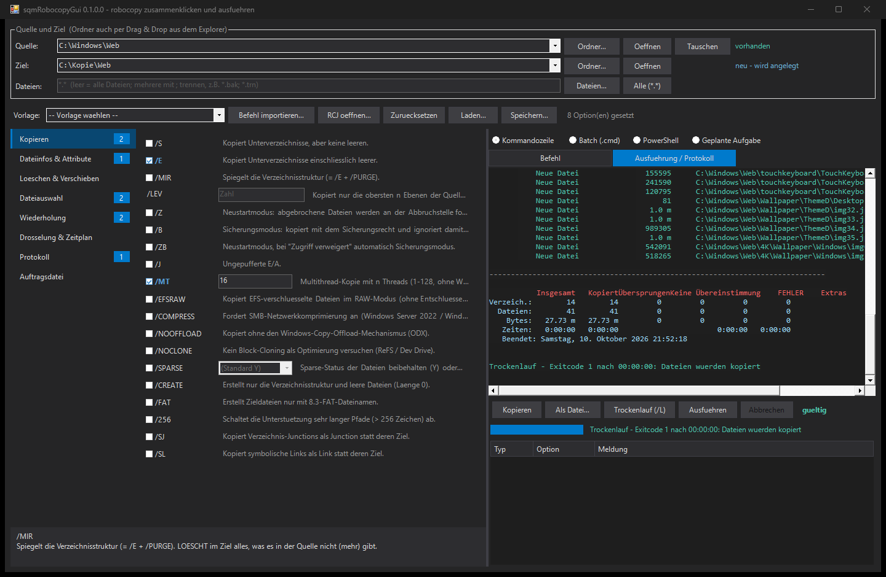

# sqmRobocopyGui

Part of the [powershelldba.de](https://www.powershelldba.de) toolset by [Uwe Janke](https://www.powershelldba.de).

PowerShell module with a WinForms GUI for **robocopy with all of its options**. Pick source and
target with the Explorer folder dialog, from the history or by drag and drop, tick the options
you need (each one with its help text), and get the finished command line immediately, checked
live for the mistakes that make robocopy fail or delete more than intended. Then run it right
there, first as a dry run with `/L`, with a live log, progress and a plain-language exit code.

No dependencies: only `robocopy.exe`, which ships with every Windows. Works in Windows
PowerShell 5.1 and PowerShell 7. The user interface is German.



**Project page:** [powershelldba.de/sqmrobocopygui](https://www.powershelldba.de/sqmrobocopygui/) ·
**Handbook (German):** [docs/AdminHandbuch.md](docs/AdminHandbuch.md), as
[PDF](https://www.powershelldba.de/sqmrobocopygui/downloads/sqmRobocopyGui-Handbuch.pdf)

## Start

```powershell
.\Start-sqmRobocopyGui.cmd                                    # straight from the folder, no install
Show-sqmRobocopyGui                                           # after Install.cmd
# Install.cmd also adds a Start menu entry "sqmRobocopyGui" (all users when run as admin, else current user)
Show-sqmRobocopyGui -Source D:\Data -Destination \\nas\backup\Data
Show-sqmRobocopyGui -CommandLine 'robocopy D:\A E:\A /MIR /R:3 /W:5'   # edit an existing line
```

## What the GUI does

- **Visual Studio dark theme** like the other powershelldba.de tools, syntax highlighting of the
  generated command.
- **Source, target, files**: modern Explorer folder dialog (address bar, quick access), history
  of the last 15 sources and targets, drag and drop of folders from Explorer (a dropped file sets
  its folder and the file name), swap button, "Open" in Explorer, status per path
  (exists / will be created / not found / no answer from the network share, checked with a
  timeout so a dead share never freezes the window).
- **All 95 options in 8 categories** (navigation list like the Visual Studio options dialog):
  copy, file info and attributes, delete and move, file selection, retry, throttling and
  schedule, logging, job files. Every option has a short help next to it, the full text below
  the list and in the tooltip. Set options are bold, destructive ones (`/MIR`, `/PURGE`, `/MOV`,
  `/MOVE`) orange, each category shows how many are set.
- **Typed inputs**: check boxes for switches, letter boxes for `/COPY`, `/DCOPY`, `/A+`, `/A-`,
  `/IA`, `/XA`, optional values for `/MT`, `/SPARSE`, `/LFSM`, file and folder pickers for
  `/XF`, `/XD`, `/LOG` and job files. Mutually exclusive options (`/S` `/E` `/MIR`, `/Z` `/B`
  `/ZB`, `/COPY` `/SEC` `/COPYALL` `/NOCOPY`, the four log variants, ...) deselect each other.
- **Presets**: copy folder, mirror, add new files only, move, server migration with ACLs, NAS /
  Linux share, large files, distribute SQL backups (`*.bak`, `*.trn`), slow WAN link, folder
  structure only, dry run. A preset keeps source, target and log file.
- **Live validation**: errors (robocopy would refuse or the combination contradicts itself) and
  hints (deletes data, runs forever, needs admin rights, no `/R` so a locked file is retried a million
  times, 30 seconds apart, log file without `/NP`, ...). Double-click jumps to the option.
- **Output formats**: command line, batch file (`chcp 65001`, `%` escaped, exit code
  evaluation: 0-7 success, 8+ error), PowerShell (argument array, `$LASTEXITCODE` check),
  scheduled task (`Register-ScheduledTask` script with daily, weekly, once or interval trigger,
  SYSTEM or current user, never overwrites an existing task).
- **Run it**: dry run with `/L` (F5) and real run (Ctrl+F5) with a confirmation that spells out
  what `/MIR` or `/MOVE` will delete, colored live log, progress of the current file, cancel
  button, and the exit code explained as text.
- **Import** an existing robocopy line (cmd, batch with `^`, PowerShell) or an `.RCJ` job file
  saved with `/SAVE`. Save and load the whole configuration as JSON.

## Scripting without the GUI

```powershell
$p = @{ Source = 'D:\Data'; Destination = '\\nas\backup\Data'; MIR = $true; MT = 16
        R = 3; W = 5; XD = '$RECYCLE.BIN; System Volume Information'; LOG = 'C:\Logs\data.log'; NP = $true }

Test-sqmRobocopyParameter -Parameter $p -CheckPath           # offline rule check (+ paths)
New-sqmRobocopyCommand   -Parameter $p                        # command line
New-sqmRobocopyCommand   -Parameter $p -Format Batch
New-sqmRobocopyCommand   -Parameter $p -Format ScheduledTask -ScheduleType Daily -ScheduleTime 22:00
& robocopy.exe @(New-sqmRobocopyCommand -Parameter $p -Format Arguments)
ConvertFrom-sqmRobocopyExitCode $LASTEXITCODE                  # 0-7 success, 8+ error, as text

ConvertFrom-sqmRobocopyCommand 'robocopy "D:\Data\" E:\Data /MIR /R:3'   # line -> hashtable
ConvertFrom-sqmRobocopyCommand -JobFile C:\Jobs\nightly.RCJ
```

Directories are always written without a trailing backslash: `"C:\Target\"` in quotes is the
classic robocopy mistake, the backslash escapes the closing quote and robocopy reports an
invalid parameter.

## Tests

```powershell
.\Tests\Test-sqmRobocopyGui.ps1          # generator, rules, import, real robocopy runs, GUI
.\Tests\Test-sqmRobocopyGui.ps1 -NoGui   # without the GUI part
```

The test lets robocopy itself parse every option (`/QUIT`), runs the generated command line,
batch file and PowerShell script against a temporary folder with spaces, an umlaut and `%` in
its name, round-trips `.RCJ` files written by robocopy, and drives the GUI including dry run,
real run and cancel. Passes in PowerShell 5.1 and 7.

## License

MIT
