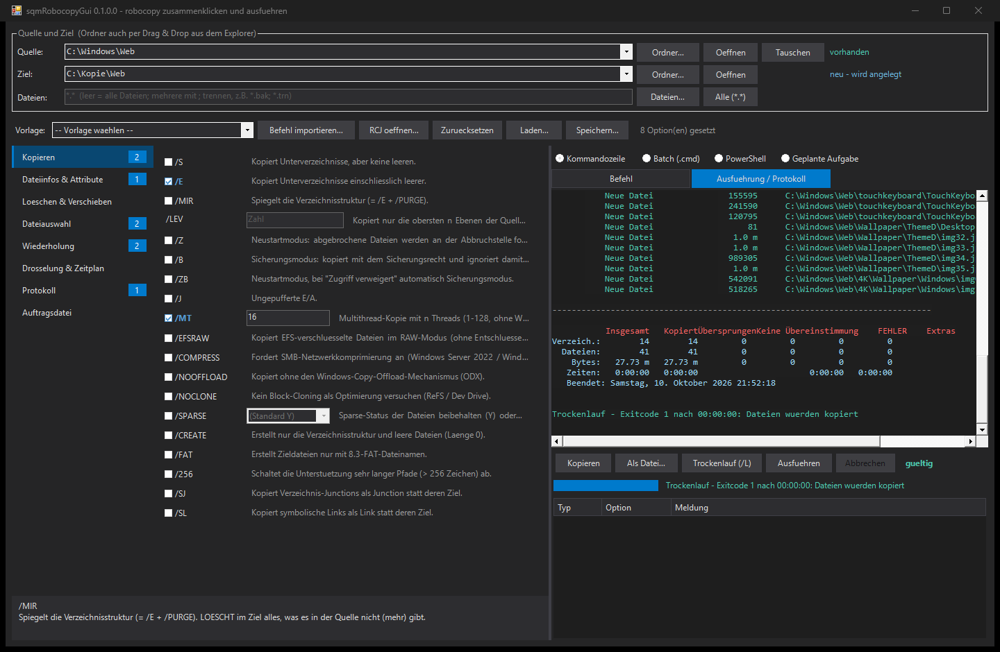

# sqmRobocopyGui - Handbuch

Stand: 2026-10-10, sqmRobocopyGui 0.1.0.0, robocopy-Optionen von Windows 11 24H2 / Server 2025.

## 1. Zweck

robocopy ist das Standardwerkzeug fuer grosse Kopien, Spiegelungen und Migrationen unter
Windows, hat aber knapp hundert Optionen mit eigener Syntax (`/COPY:DAT`, `/RH:2200-0600`,
`/MAXAGE:20260101`). Typische Fehler fallen erst beim Lauf auf: `"C:\Ziel\"` in
Anfuehrungszeichen (der Backslash maskiert das Anfuehrungszeichen, robocopy meldet "Ungueltiger
Parameter"), `/MIR` auf das falsche Ziel, kein `/R` (eine gesperrte Datei wird eine Million Mal
im Abstand von 30 Sekunden wiederholt), Protokolldatei voller Prozentangaben.

sqmRobocopyGui baut den Aufruf per Mausklick zusammen, erklaert jede Option, prueft die
Kombination sofort, gibt das Ergebnis als Kommandozeile, Batch, PowerShell oder geplante Aufgabe
aus und fuehrt robocopy auf Wunsch direkt aus, zuerst als Trockenlauf.

## 2. Start und Installation

| Weg | Befehl |
|---|---|
| Ohne Installation | `Start-sqmRobocopyGui.cmd` im Modulordner doppelklicken |
| Installation | `Install.cmd` (AllUsers mit UAC) oder `Install.cmd CurrentUser` |
| Nach Installation | `Show-sqmRobocopyGui`, optional `-Source`, `-Destination`, `-CommandLine` |

Voraussetzungen: Windows PowerShell 5.1 oder PowerShell 7 unter Windows, .NET Framework 4.5.
Keine weiteren Module; robocopy.exe ist Teil von Windows. Fuer `/B`, `/ZB`, `/COPYALL` und
`/COPY` mit S, O oder U die GUI als Administrator starten (die Titelleiste zeigt
`[Administrator]`).

## 3. Aufbau der Oberflaeche



1. **Quelle und Ziel**
    - **Ordner...** oeffnet den Explorer-Ordnerdialog mit Adressleiste und Schnellzugriff (auch
      unter PowerShell 5.1, dort sonst nur der alte Baumdialog). Er startet im aktuellen Pfad
      bzw. dessen naechstem vorhandenen Elternordner.
    - **Drag & Drop**: Ordner aus dem Explorer auf Quelle oder Ziel ziehen. Eine gezogene Datei
      setzt deren Ordner; auf der Quelle wird zusaetzlich der Dateiname in "Dateien" eingetragen.
    - Die Klappliste merkt sich die letzten 15 Quellen und Ziele (`%APPDATA%\sqmRobocopyGui\config.json`,
      gespeichert beim Ausfuehren).
    - **Oeffnen** zeigt den Ordner im Explorer, **Tauschen** vertauscht Quelle und Ziel.
    - Rechts steht der Pfadstatus: *vorhanden*, *neu - wird angelegt* (Ziel), *nicht gefunden*
      (Quelle) oder *keine Antwort (Netzwerk?)*. Die Pruefung laeuft mit 1,5 s Zeitlimit,
      eine nicht erreichbare Freigabe friert das Fenster also nicht ein.
    - **Dateien**: Namen oder Platzhalter, mehrere mit `;` getrennt, leer = alle. **Dateien...**
      waehlt Dateien per Dialog (nur die Namen werden uebernommen; liegen sie in einem anderen
      Ordner als der Quelle, bietet die GUI an, die Quelle umzustellen).
2. **Werkzeugleiste**: Vorlage, Befehl importieren, RCJ oeffnen, Zuruecksetzen (alle Optionen
   leeren, Pfade bleiben), Einstellungen laden/speichern, Anzahl gesetzter Optionen, Meldungen.
3. **Optionen** links: Kategorienliste wie im Optionen-Dialog von Visual Studio, die Zahl zeigt
   die gesetzten Optionen je Kategorie. Jede Zeile hat eine Kurzhilfe, die vollstaendige Hilfe
   steht unten und im Tooltip. Gesetzte Optionen sind fett, loeschende (`/MIR`, `/PURGE`, `/MOV`,
   `/MOVE`) orange.
4. **Ausgabe** rechts: Format, Befehl bzw. Ausfuehrungsprotokoll, Aktionen, Fortschritt,
   Pruefliste.

### Eingabearten

| Art | Beispiel | Bedienung |
|---|---|---|
| Schalter | `/E`, `/XO`, `/NP` | Haekchen |
| Zahl | `/R:3`, `/LEV:2`, `/IPG:50` | Zahl eintragen |
| optionaler Wert | `/MT`, `/MT:16`, `/SPARSE:N`, `/LFSM:5G` | Haekchen, Wert leer = robocopy-Standard |
| Buchstaben | `/COPY:DATS`, `/DCOPY:DAT`, `/XA:SH` | Buchstaben ankreuzen, Tooltip erklaert jeden |
| Groesse | `/IoRate:50M`, `/Threshold:1G` | n oder n mit K, M, G |
| Bytes | `/MAX:1048576` | nur Zahl, robocopy kennt hier kein K/M/G |
| Alter | `/MAXAGE:7`, `/MINAGE:20260101` | unter 1900 = Tage, sonst JJJJMMTT |
| Zeitfenster | `/RH:2200-0600` | hhmm-hhmm, ueber Mitternacht erlaubt |
| Liste | `/XF *.tmp Thumbs.db`, `/XD ~snapshot` | mit `;` trennen, **...** waehlt Dateien bzw. Ordner (Mehrfachauswahl mit Strg) |
| Pfad | `/LOG:C:\Logs\x.log`, `/SAVE:...` | **...** oeffnet den Speichern- bzw. Oeffnen-Dialog |

Fuer `/XD` werden Unterordner der Quelle als Name eingetragen, andere Ordner mit vollem Pfad.

### Sich ausschliessende Optionen

Wer eine Option einer Gruppe setzt, nimmt die anderen zurueck:
`/S` `/E` `/MIR` · `/Z` `/B` `/ZB` · `/COPY` `/SEC` `/COPYALL` `/NOCOPY` · `/DCOPY` `/NODCOPY` ·
`/MOV` `/MOVE` · `/A` `/M` · `/LOG` `/LOG+` `/UNILOG` `/UNILOG+`.

## 4. Vorlagen

| Vorlage | Optionen |
|---|---|
| Ordner kopieren | `/E /DCOPY:DAT /MT /R:3 /W:5` |
| Spiegeln /MIR | `/MIR /DCOPY:DAT /MT /XJ /R:3 /W:5` |
| Nur Neues ergaenzen | `/E /XO /XC /XN /R:3 /W:5` (nur fehlende Dateien, nichts wird ueberschrieben) |
| Verschieben | `/MOVE /E /R:3 /W:5` |
| Server-Migration mit Rechten | `/MIR /COPYALL /DCOPY:DAT /ZB /MT:32 /XJ /R:1 /W:1 /NP` (Administrator) |
| NAS / Linux-Freigabe | `/E /FFT /DST /Z /XJ /R:3 /W:10` |
| Grosse Dateien | `/E /J /R:3 /W:10` |
| SQL-Backups verteilen | Dateien `*.bak; *.trn`, `/S /J /XO /R:3 /W:10` |
| Langsame WAN-Leitung | `/E /Z /COMPRESS /MT:4 /R:10 /W:30` |
| Nur Ordnerstruktur | `/E /XF * /R:1 /W:1` |
| Trockenlauf | `/E /L /R:1 /W:1` |

Eine Vorlage ersetzt alle Optionen, behaelt aber Quelle, Ziel, Protokolldatei und (sofern die
Vorlage keine eigenen setzt) die Dateimuster.

## 5. Pruefung

Unten rechts stehen **Fehler** (robocopy wuerde den Aufruf ablehnen oder er widerspricht sich)
und **Hinweise** (zulaessig, aber riskant oder vermutlich nicht gewollt). Doppelklick springt
zur Option.

Fehler, unter anderem:

- Quelle oder Ziel fehlt (ausser mit `/NOSD` / `/NODD`), Quelle = Ziel, Platzhalter im Pfad
- Quelle liegt im Ziel und `/MIR` oder `/PURGE` ist gesetzt (wuerde das Ziel bis auf die Quelle
  leeren)
- mehrere Optionen einer exklusiven Gruppe
- Wertebereiche und Formate: `/MT` 1-128, `/MAX` und `/MIN` nur Bytes, `/MIN` groesser `/MAX`,
  gueltiges Datum bei `/MAXAGE` u.a., `/RH`-Format, erlaubte Buchstaben bei `/COPY` usw.
- `/MT` mit `/IPG` oder `/EFSRAW`

Hinweise, unter anderem:

- `/MIR`, `/PURGE`, `/MOV`, `/MOVE` loeschen (entfaellt mit `/L`); `/MIR` auf eine Laufwerks-
  oder Freigabewurzel
- Ziel liegt in der Quelle (Kopie in sich selbst)
- kein `/R`; `/MON` oder `/MOT` (robocopy endet nicht); `/REG` aendert die Standardwerte
- Protokolldatei ohne `/NP`; `/TEE`, `/PF`, `/XX`, `/Threshold` ohne ihre Partneroption
- relative Pfade, Pfade in Dateimustern
- Optionen, die Administratorrechte brauchen

Vor dem echten Lauf prueft die GUI zusaetzlich, ob die Quelle erreichbar ist und das
Ziellaufwerk bzw. die Zielfreigabe existiert.

## 6. Ausgabeformate

| Format | Inhalt |
|---|---|
| Kommandozeile | eine Zeile `robocopy ...`, nur noetige Anfuehrungszeichen |
| Batch (.cmd) | `chcp 65001` (Umlaute in Pfaden), `%` als `%%`, Exitcode-Auswertung: 0-7 = OK und `exit /b 0`, ab 8 = Fehler mit dem Exitcode |
| PowerShell | Argument-Array, `& robocopy.exe @robocopyArgs`, `throw` ab Exitcode 8 |
| Geplante Aufgabe | PowerShell-Skript mit `Register-ScheduledTask`: Name (automatisch "Robocopy Quelle nach Ziel"), Ordner in der Aufgabenplanung (Standard `\sqmRobocopy\`), Konto, Zeitplan |

Verzeichnisse werden immer ohne abschliessenden Backslash geschrieben, Laufwerkswurzeln als `D:\`
ohne Anfuehrungszeichen.

**Geplante Aufgabe**

- Konto **SYSTEM**: laeuft ohne Anmeldung, Netzwerkfreigaben mit dem Computerkonto
  (`DOMAENE\RECHNER$`), Anlegen nur als Administrator.
- Konto **aktueller Benutzer**: laeuft nur, solange der Benutzer angemeldet ist, mit dessen
  normalen Rechten; kann ohne Administratorrechte angelegt werden.
- Zeitplan: keiner (nur manuell), einmalig, taeglich, woechentlich (Tage waehlbar), Intervall
  in Minuten ab einer Uhrzeit.
- Einstellungen: verpasste Laeufe nachholen, keine parallele Instanz, Laufzeitgrenze 72 Stunden.
- Existiert eine Aufgabe gleichen Namens, bricht das Skript ab und aendert nichts.
- In der Aufgabenplanung bedeutet "Letztes Ergebnis" 0x0 bis 0x7 Erfolg, ab 0x8 Fehler.

**Aufgabe anlegen...** fuehrt das Skript nach Rueckfrage direkt aus.

## 7. Ausfuehren

- **Trockenlauf (/L)** oder **F5**: robocopy listet nur auf, was passieren wuerde. Es wird
  nichts kopiert, geloescht oder geaendert.
- **Ausfuehren** oder **Strg+F5**: vorher eine Rueckfrage. Bei `/MIR`, `/PURGE`, `/MOV`,
  `/MOVE`, `/MON` und `/MOT` nennt sie ausdruecklich, was geloescht wird bzw. dass der Lauf nicht
  von selbst endet; "Nein" ist dann vorausgewaehlt.
- Bei Fehlern in der Pruefliste startet nichts.
- Das **Protokoll** zeigt robocopys Ausgabe live und farbig: neue Dateien gruen, aeltere bzw.
  geaenderte blau, `*EXTRA` (wird von `/MIR` geloescht) orange, Fehler rot.
- Darunter: Fortschrittsbalken der aktuellen Datei, Laufzeit und Dateiname.
- **Abbrechen** beendet robocopy sofort.
- Am Ende steht der Exitcode als Text, z.B. "Exitcode 3: Dateien kopiert, zusaetzliche
  Dateien/Verzeichnisse im Ziel".
- Ist eine Protokolldatei gesetzt, ergaenzt die GUI `/TEE`, damit die Ausgabe trotzdem im Fenster
  erscheint (nur fuer diesen Lauf, nicht im angezeigten Befehl).

| Exitcode | Bedeutung |
|---|---|
| 0 | nichts zu tun, Quelle und Ziel sind synchron |
| 1 | Dateien kopiert |
| 2 | zusaetzliche Dateien/Verzeichnisse im Ziel |
| 4 | abweichende Dateien/Verzeichnisse (Mismatch) |
| 8 | einige Dateien/Verzeichnisse konnten nicht kopiert werden |
| 16 | schwerer Fehler, nichts kopiert (Parameter, Zugriff, Pfad) |

Die Werte sind eine Bitmaske: 3 = 1 + 2. Alles unter 8 ist Erfolg.

## 8. Importieren, Speichern, Laden

- **Befehl importieren...**: eine vorhandene robocopy-Zeile einfuegen (cmd, Batch mit
  `^`-Fortsetzung, PowerShell mit Hochkomma-Argumenten). Steht in der Zwischenablage eine
  robocopy-Zeile, ist sie schon eingetragen. Unbekannte Optionen werden gemeldet und
  uebersprungen.
- **RCJ oeffnen...**: eine mit `/SAVE` gespeicherte Auftragsdatei einlesen. robocopy schreibt
  diese Dateien je nach Umgebung in der OEM-, ANSI- oder UTF-8-Kodierung; die GUI erkennt das.
  Hinweis: robocopy speichert dort u.a. `/MT`, `/IoRate` und `/LFSM` nicht mit.
- **Speichern... / Laden...**: Pfade, Optionen, Ausgabeformat und Aufgaben-Einstellungen als
  JSON, z.B. um Standard-Konfigurationen im Team zu teilen.
- **Kopieren / Als Datei...**: den angezeigten Befehl in die Zwischenablage bzw. als `.cmd`
  (UTF-8 ohne BOM, passend zu `chcp 65001`) oder `.ps1` (UTF-8 mit BOM) speichern.

## 9. Skripting

```powershell
$p = @{ Source = 'D:\Daten'; Destination = '\\nas\backup\Daten'; MIR = $true; MT = 16
        R = 3; W = 5; XD = '$RECYCLE.BIN; System Volume Information'; LOG = 'C:\Logs\daten.log'; NP = $true }

Test-sqmRobocopyParameter -Parameter $p -CheckPath
New-sqmRobocopyCommand -Parameter $p -Format Batch
New-sqmRobocopyCommand -Parameter $p -Format ScheduledTask -ScheduleType Weekly -ScheduleWeekDays Saturday -ScheduleTime 23:00
& robocopy.exe @(New-sqmRobocopyCommand -Parameter $p -Format Arguments)
ConvertFrom-sqmRobocopyExitCode $LASTEXITCODE
ConvertFrom-sqmRobocopyCommand 'robocopy D:\A E:\A /MIR /R:3'
```

Schluessel im Hashtable: `Source`, `Destination`, `Files` und jede Option ohne Schraegstrich
(`'LOG+'`, `'A-'` in Anfuehrungszeichen). Schalter als `$true`, optionale Werte als `$true` oder
Wert, Listen als Array oder `;`-getrennt.

## 10. Tests

```powershell
.\Tests\Test-sqmRobocopyGui.ps1
```

Der Test laesst robocopy jede Option selbst auswerten (mit `/QUIT`), fuehrt Kommandozeile, Batch
und PowerShell-Skript gegen einen Testordner mit Leerzeichen, Umlaut und `%` im Namen aus, liest
von robocopy geschriebene RCJ-Dateien ein und bedient die GUI inklusive Trockenlauf, Lauf und
Abbruch. Kommt mit einem neuen Windows-Release eine neue robocopy-Option hinzu, gehoert sie in
`Private\srgParameters.ps1`.
